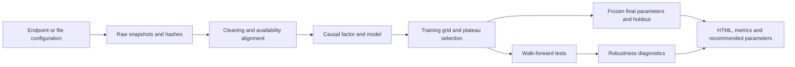

# Alphora pipeline

Put your Cybotrade endpoint topics in a strategy JSON file, define how their values form a factor, and run one command. The pipeline downloads or reads data, records immutable snapshots, cleans and aligns observations, computes causal transformations, selects a stable Sharpe plateau, performs walk-forward analysis and an untouched holdout, runs robustness diagnostics, and writes an interactive offline HTML report plus numerical artifacts.

Inspired by the [Alphora-Quant single-backtest framework](https://github.com/doi-doi/Alphora-Quant/tree/main/backtest%20framework/single%20backtest), inspected at commit `fafd274cbaf9bdb05cf68012118a8dd60b59ea1f`. Implementation is independent: configuration replaces global module settings, paths are portable, credentials stay in `.env`, and selection never uses test or holdout performance.



## Install on Windows / PyCharm

Use Python **3.13 or 3.14**. On this machine the project already has a `.venv` interpreter.

```powershell
git clone https://github.com/doi-doi/alphora-pipeline.git
cd alphora-pipeline
py -3.14 -m venv .venv
.\.venv\Scripts\python.exe -m pip install -e ".[live,dev]"
Copy-Item .env.example .env
```

Set the key in the project-root `.env`:

```dotenv
CYBOTRADE_API_KEY=your_key_here
CYBOTRADE_API_URL=
```

`CYBOTRADE_API_URL` is optional. Leave it blank to use the official API. `.env`, downloaded data, cache, logs and generated reports are ignored by Git. Do not paste keys into strategy files. For an offline-only installation use `pip install -e ".[dev]"`.

In PyCharm:

1. Open this repository folder.
2. Select **Existing interpreter** → `.venv\Scripts\python.exe`.
3. Open `run_pipeline.py`. Set `CONFIG_PATH` to your strategy file, or add `--config configs/OPT25D_OI_03_01.json` in Run Configuration parameters.
4. Run the script. The console prints the completed `report.html` and `recommended_parameters.json` paths. Add `--open` to open the report automatically.

The runner resolves its default configuration relative to its own location. Data paths in a JSON config resolve relative to that config, so PyCharm's working directory does not change file resolution. You can also import `alphora_pipeline.pipeline.run` from your own code.

## First run

Run the full pipeline without a key using clearly labelled synthetic data:

```powershell
.\.venv\Scripts\python.exe -m alphora_pipeline.cli demo --open
```

Then edit `configs/endpoint.json` and run a real endpoint:

```powershell
.\.venv\Scripts\python.exe -m alphora_pipeline.cli validate --config configs/endpoint.json
.\.venv\Scripts\python.exe run_pipeline.py --config configs/endpoint.json --open
```

Generate your own starter configuration:

```powershell
.\.venv\Scripts\python.exe -m alphora_pipeline.cli init --name my_strategy --topic "glassnode|derivatives/options_25delta_skew_1_week?a=BTC&e=deribit&i=1h" --column v --end "2026-09-12T01:00:00Z" --output configs/my_strategy.json
```

Endpoints identify data, not a complete strategy. The endpoint-only template tests a rolling normalization of its values. To express an idea such as “negative skew change multiplied by an open-interest growth gate,” define the factor graph. The five `OPT25D_OI_*.json` examples supply the earlier formulas, models, original baseline parameters and grids. `OPT25D_OI_02_03` retains a prominent known-reconstruction-mismatch note; its original transformation remains unverified.

## Strategy configuration

JSON was chosen to avoid hidden executable configuration. Main sections:

| Section | What you set |
|---|---|
| `name`, `start`, `end` | Safe output name, first research decision timestamp, exclusive end |
| `frequency`, `warmup_bars` | Signal interval and extra history loaded before research starts |
| `sources` | Alias → topic or local file, value column, timestamp column/unit, availability lag |
| `price` | Price endpoint/file and close column |
| `factor` | Ordered named transformation graph and output node |
| `grid` | Model families, rolling windows, long/short thresholds and optional factor parameters |
| `cleaning` | Duplicate policy, missing-data policy, bounded forward fill, allowed missing fraction |
| `execution` | Fee/slippage in **basis points**, price sampling, minute shift and invalid-signal policy |
| `signal` | Trend/fast, normal/reverse, long/short/both, crossed-threshold policy |
| `optimization` | Plateau method/tolerance and training eligibility |
| `walk_forward` | Training/test months, holdout months, embargo and minimum test bars |
| `robustness` | Cost/slippage/delay scenarios, bootstrap blocks/samples, placebo samples and seed |
| `baseline_parameters` | Optional original fixed parameters for a descriptive baseline |

Defaults retain BTCUSDT examples, hourly signals, 3.5 bps (0.035%) per unit of turnover, six-month training and three-month tests. The approved default reserves the final three calendar months as a holdout. Defaults are recorded in every run's `resolved_config.json`.

### Source alignment and cleaning

Raw SDK timestamp integers default to milliseconds. CSV ISO dates are supported; set `timestamp_unit` to `iso`. Units `s`, `ms`, `us` and `ns` are explicit. Source columns are numeric; invalid or infinite values become audited missing values. Duplicate timestamps fail by default. Choose `first` or `last` only when you know the provider's duplicate semantics.

`availability_lag_minutes` shifts observation availability forward, then rounds up to the signal decision grid. Negative lag is prohibited. Use the provider's actual publication delay; zero is an assumption. This does not reconstruct point-in-time vintages of revised historical data. Sources must have at most one aligned observation per signal bar; aggregate a higher-frequency factor explicitly upstream rather than silently merging values.

Missing research factor values fail by default. `missing: "ffill"` fills from the past for at most `ffill_limit_bars`; `keep` leaves gaps. Both still enforce `max_missing_fraction`. Warm-up gaps are counted separately and can result in skipped training windows. Missing/nonpositive execution prices always fail. The pipeline never backward-fills or silently interpolates prices. Market outliers are retained unless you explicitly add a causal rolling clipping transformation.

### Factor graphs

Each node has `name`, `op` and `input` (unary) or `inputs` (binary). Supported operations:

- `identity`, `log`, `log1p`, `diff`, `pct_change`, `abs`, `negate`, `square`, `sqrt`.
- `rolling_mean`, `rolling_std`, `zscore`, `percentile_rank`, `rolling_clip`.
- `add`, `subtract`, `multiply`, `divide`, `gt`, `lt`, `and`.

Windows require all past observations; standard deviations use `ddof=1`. Rolling ranks use average ties. Log of a nonpositive value and division by zero become missing, not arbitrary constants. Rolling clipping estimates quantiles on the preceding rows, excluding the current row.

```json
"factor": {
  "steps": [
    {"name": "delta", "op": "diff", "input": "endpoint", "periods": 24},
    {"name": "normalized", "op": "zscore", "input": "delta", "window": {"param": "factor_window"}},
    {"name": "negative", "op": "negate", "input": "normalized"}
  ],
  "output": "negative"
}
```

Add `"factor_window": [168, 336, 720]` to `grid` to optimize that transformation window along with the signal model. No Python `eval` is used. Extend the small operation/model registry in `transforms.py` for a custom formula, and add a prefix-causality test.

Models: `identity`, `zscore`, `ezscorev1`, `percentile_rank`, `percentilerank_meannorm`, `minmax`, `robust_zscore`. `ezscorev1` uses exponentially weighted mean and unbiased standard deviation, `adjust=False`, with span equal to the window. The reconstructed `percentilerank_meannorm` ranks values and normalizes rank by its rolling mean/range; the original `02_03` implementation has not been established. Do not compare different model families with the same thresholds without checking their signal scales.

### Execution timing and accounting

For the previous minute-price evaluator, hourly `bar_last` sampling plus a 70-minute shift selects the timestamp **decision start + 59 minutes + 70 minutes = +129 minutes**. This is represented explicitly; it is not described as execution at +70 minutes. `bar_start` with a zero shift samples the decision timestamp instead. Timestamp lookup avoids a missing minute changing a row-shift interpretation.

PnL is `previous_position * price_return - abs(position - previous_position) * (fee_bps + slippage_bps) / 10000`. Every train/test/holdout backtest starts flat. A reversal costs two turnover units. Positions are -1, 0 or 1 with no leverage. Invalid model values flatten by default; `hold` can preserve the previous position. `trend` holds between thresholds; `fast` is flat between thresholds. `*_reverse` reverses direction. Crossed thresholds give short priority unless `overlap: "reject"` excludes those candidates.

Training excludes rows whose sampled execution price occurs at or after the selection boundary, plus any configured embargo. This matters whenever the price sampling delay extends beyond a signal bar. Training selection is therefore stricter than the previous backtest_wf reproduction.

The last development test is also shortened when necessary so its sampled prices stay before the holdout boundary. With the hourly +129-minute convention this removes the last two development decision bars. The report shows the actual test endpoints.

## Parameter selection and validation

Each training window evaluates the complete declared grid. Candidates need enough finite model bars, at least the configured number of trade events, and a defined Sharpe. A window without an eligible candidate is **skipped and reported**, never assigned a fictitious zero-score winner.

Default `connected_plateau`:

1. Keep candidates within `max(0.1, abs(best_train_sharpe) * 0.1)` of the best eligible Sharpe (tolerances configurable).
2. Connect immediate numeric-axis neighbors within each model family.
3. Prefer the largest near-best connected component, then its median Sharpe.
4. Select the discrete point nearest that component's centroid, with deterministic tie-breaking.

This improves the earlier global-grid-center method, which could select a point unrelated to a stable neighboring region. `legacy_grid_center` remains configurable for comparison. A single-point plateau is visibly flagged. There is no guarantee of future optimality, and a negative best score is reported candidly.

Walk-forward parameters come only from the six months before each test. Test blocks are stitched after flat resets. Missing/skipped periods remain gaps; coverage is reported. Final recommended parameters are fitted on the final **pre-holdout** training window and frozen for the untouched holdout. The retrospective full-history curve is labelled descriptive and never used as evidence of OOS performance. The pipeline does not use robustness or holdout scores to choose parameters.

Changing source data or configurations after inspecting the holdout makes that interval research data. Reserve fresh dates for subsequent honest validation. The large search space is recorded; this first version does not claim a selection-adjusted statistical significance test or probability of backtest overfitting.

## Robustness and outputs

Robustness includes higher fees, explicit slippage assumptions, one/two-bar execution delays, neighboring parameters on the final training period, yearly OOS performance, parameter changes across folds, a seeded moving block bootstrap of stitched OOS PnL, and fixed-decision circular-return-shift placebo diagnostics. Bootstrap/placebo results are **conditional** diagnostics; neither reruns the full grid-selection procedure, so they do not correct for strategy mining. There is no synthetic pass/fail badge claiming a strategy is robust.

Every successful run creates a new `runs/<strategy>/<UTC timestamp>_<id>/` folder:

| Output | Contents |
|---|---|
| `report.html` | Offline interactive charts, metrics, folds, parameter surface, cleaning, sources and caveats |
| `recommended_parameters.json` | Frozen candidate, plateau evidence and precise training/as-of dates |
| `summary.json`, `fold_metrics.csv` | Full metrics and tested/skipped fold results |
| `training_grid.csv` | Every training candidate, eligibility, scores and reasons |
| `robustness.json` | Cost/delay/neighborhood/resampling diagnostics |
| `raw/*.parquet`, `cleaned.parquet` | Immutable inputs and aligned observations |
| `walk_forward.parquet`, `holdout.parquet` | Hourly/signal-frequency PnL and positions |
| `descriptive_full_history.parquet`, `baseline.parquet` | Explicitly retrospective curves; baseline optional |
| `quality.json`, `provenance.json`, `manifest.json` | Cleaning counts, raw hashes, dependency versions, Git revision and output hashes |
| `resolved_config.json`, `status.json`, `pipeline.log` | Configuration, stage/status and progress |

Metrics include Sharpe, Sortino, additive/annualized return, drawdown, Calmar, volatility, exposures, bar win rate/profit factor, trade-event count, turnover, costs and drawdown duration. Sharpe uses sample standard deviation and frequency-derived annualization (8,760 bars/year for hourly signals). Ratios with zero denominators are null, not invented infinities. Bar metrics are not closed-trade metrics. Funding, liquidation, leverage, bid/ask microstructure, volume capacity and market impact are outside the current accounting model.

Use `--cache <folder>` for SDK cache placement, `--refresh` to refresh cached observations, `--output <folder>` for output placement and `--env-file <path>` for an explicit local key file. Retain raw snapshots and hashes to compare data revisions across runs. Downloading a fresh snapshot can change historical results.

## Development and tests

```powershell
.\.venv\Scripts\ruff.exe check src tests
.\.venv\Scripts\python.exe -m pytest -q
```

Tests exercise analytical fee/reversal accounting, flat-start slicing, price timing, availability lags, missing/duplicate handling, prefix causality, connected plateaus, future/holdout isolation and warm-up guards. CI covers Windows/Linux on Python 3.13/3.14. Live endpoint requests are separate manual integration checks and require a local key; CI never needs credentials.

`requirements-lock.txt` records the exact packages used for the verified Windows Python 3.14 environment. For that environment, install it before `pip install -e ".[live,dev]"`; use `pyproject.toml` ranges for another platform/Python version. Offline CI uses the declared core/dev requirements.

To verify calculation parity against saved earlier outputs without requesting data:

```powershell
.\.venv\Scripts\python.exe tools/verify_previous_baselines.py --results "C:\Users\User1\Documents\Alphora\Alphora Backtest\results"
```

This compares the earlier raw factors, fixed positions and per-bar PnL for all five strategies. It establishes parity with the saved reconstruction, including `02_03`, whose original HTML mismatch remains unresolved. The normal pipeline's added warm-up, connected plateau, eligibility, execution-time purge and holdout deliberately change the later walk-forward research procedure.
